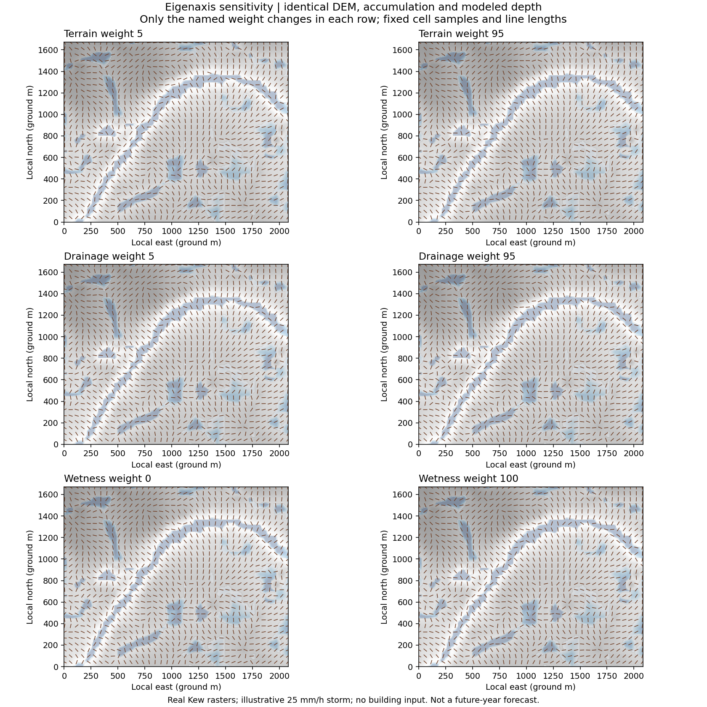
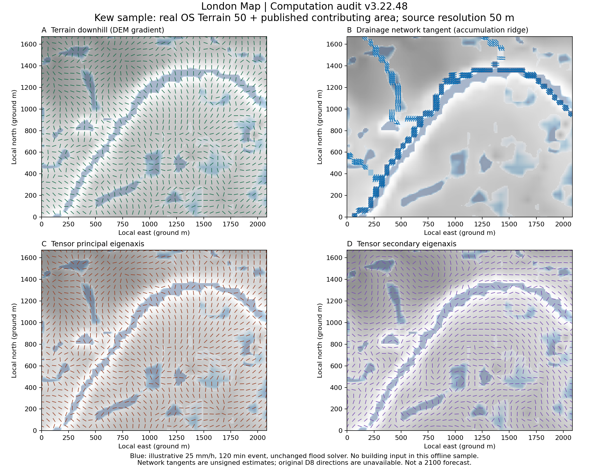

# London Map 第二步：连续二维对称张量场

版本：v3.22.48-tensor-continuity。计算沿用第一步确认的同一网格、DEM、汇水面积及当年模拟水深。无道路生成或新视觉特效；原洪水求解器未修改。

## 方向结构

T₀ = wₜ T地形 + wᵈ T排水 + wʰ T水头，三个权重均作用于矩阵和最终特征方向，不控制展示数量。

- **区域地势**：同一 OS Terrain 50 在不小于 150 m 支持范围内计算低频地势方向。与不小于 50 m 支持的局部地形方向按 30% / 70% 组合；区域支持不足时使用有依据的局部方向。支持范围不是新增高分辨率数据。
- **排水通道**：保留第一步对真实汇水面积脊线的切线估计及形态置信度。只在达到地图相同面积阈值、有方向证据的位置加权；不把 DEM 下坡再次当作排水方向。
- **动态水文**：从当帧地形高程 + 水深计算水头方向，禁止穿过建筑或斜切墙角。积水权重按 d/(d+0.14m) 平滑增长，结合实际方向置信度；不存在额外的年份旋转因子。
- **主次方向**：以较大特征值对应的方向为主轴，以较小特征值的特征方向为正交次轴。次轴不是独立实测水流。冲突导致接近各向同性时，降低置信度；奇点处不强行编造唯一主方向。

## 连续性和障碍

方向以对称张量分量 / 二倍角表达，避免把相差 180° 的同一条轴互相抵消。正则化使用物理米计的近邻与不小于 50m 的邻域连接，迭代始终锚定原始证据。湿干差异和汇水差异限制跨边界平滑；跨建筑、场地外和缺测区的连接被剔除。

建筑邻近带内，削弱指向墙体的法向分量，将受阻的方向能量转到几何切线；此变换保留矩阵半正定和迹。它是建筑几何约束，不是实测流速或新增水量。无证据的区域不会仅因靠近建筑而生成方向。

新增原始输出：anisotropy（特征值差/和）、directionContinuity（无向邻域一致度）、terrainCueWeight、drainageCueWeight、hydraulicCueWeight、obstacleConstraint、dominantProcess，以及区域地势方向和置信度。权重是局部有效权重；dominantProcess 指最强原始输入过程，而非土地用途。

## 2026—2100 的行为

2026 年水深为零时，地形和受支持的排水方向仍形成完整基础张量。之后显示端始终读取同一套综合特征轴，替换了旧版“静态 DEM 常显 + 湿区综合轴”的叠加方式。全年显示完整计算场；不再用年份控制方向线的逐年数量前缀。

改变情景和年份会由已有洪水模块给出对应的水深状态，再重算本地张量。只有年份标签变化而 DEM、汇水及水深相同时，方向完全相同；在无水头梯度或多依据平行的区域，即使提高积水权重，也应主要改变证据强度而不是强行转向。

## 真实栅格的权重验证

每行只改变一种权重，左右使用相同 DEM、汇水和水深，相同取样点与线段长度。其余权重保持默认 35 / 45 / 70，方向平滑为 60。夹角取主轴无向夹角 0—90°；下列各行按相应依据有效的位置统计，因此不同参数行的样本集合不同。

| 改变参数 | 比较网格 | 方向变化中位数 | 方向变化 >5° 的格数 |
| --- | ---: | ---: | ---: |
| 地形权重 5→95 | 39,509 | 3.28° | 15,988 |
| 汇水权重 5→95 | 2,214 | 63.21° | 2,006 |
| 积水权重 0→100 | 10,059 | 15.94° | 7,732 |

平滑由 0 提高到 100，使用双方都有效的同一批相邻单元对，无向方向粗糙度从 0.029236 降至 0.018130，下降 **38.0%**。这是该样区上的计算指标，不代表所有场地都必然取得同样比例。

样区仍为 Kew：西经 0.31—0.28°、北纬 51.475—51.490°。输入为仓库真实 DEM 和汇水派生栅格，源文件哈希与 metadata.json 一致；演示水深由保留的洪水求解器在 25mm/h、120分钟、入渗0.5mm/h 下计算。该事件不是实测降雨或 2100 年预测。样区共 39,917 个有效格；干态得到 39,908 格有唯一方向的张量，湿态得到 39,909 格。最大特征方向矩阵残差约 5.88×10⁻⁸。

与第一步之前的原洪水提交比较，模拟水深逐格逐位一致，体积统计一致。没有修改洪水物理参数或原统计尺度。

## 测试与限制

17 组回归测试通过，覆盖三种权重独立转向、干态基础场、同址水深渐增、固定状态换年份不变、平滑减少方向跳变、建筑法向约束、墙两侧张量不互相泄漏、半正定及正交特征方向、缺测、网格一致性、异步帧，以及 2026 干态显示端读取综合轴。

当前数据限制继续保留：排水切线来自真实汇水栅格的形态推导，缺少原始 D8 编码，不能宣称上下游连接已验证。真实样区没有输入建筑；建筑约束由合成几何测试验证。没有进行浏览器中真实建筑加载的现场验收。平滑、权重、障碍带是明确的设计方向场参数，不是经过标定的工程水力模型。

原始数组：`getLondonHydroTensorFieldData()`；四方向 GeoJSON：`getLondonHydroTensorDiagnostics(4)`。诊断 GeoJSON 现包含各向异性、连续性、有效权重和障碍约束。

测试：`node scripts/test_hydro_tensor.mjs`。重建样区及权重对照：`python scripts/build_tensor_audit.py`。机器可读结果：[tensor-continuity.json](tensor-continuity.json)。
