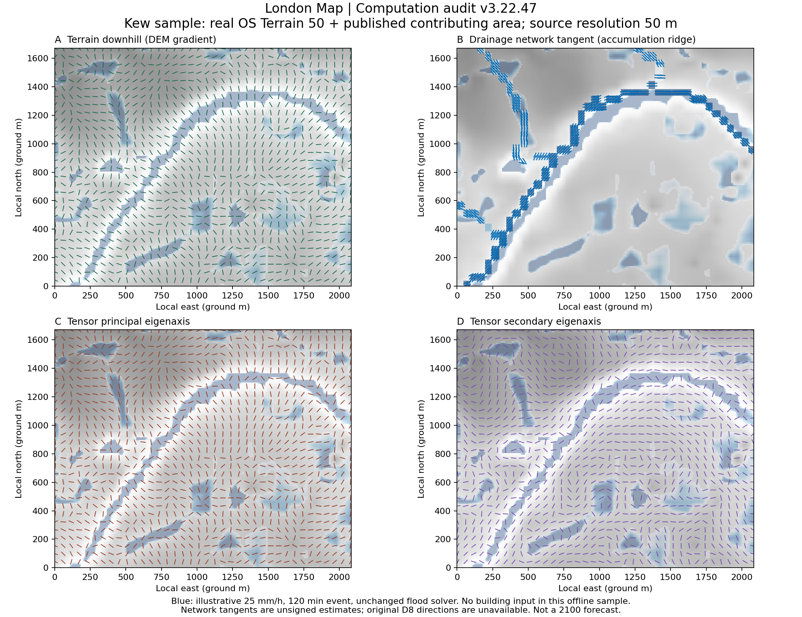

# London Map 水文张量计算审查 · v3.22.47

本次修改计算逻辑、数据同步和坐标传递，未调整 UI、发光参数或动画算法。原洪水求解过程保留。

## 查明并修复的问题

| 环节 | 原逻辑问题 | 修复 |
| --- | --- | --- |
| 汇水方向 | DEM 下坡角度被同时当作地形轴和排水轴；汇水量只加强相同方向 | 对已发布汇水面积栅格的高值脊线作局部加权 PCA，独立估计网络切线；不再回退到 DEM 下坡 |
| 共同网格 | 张量按范围宽高除以行列数重建单元；洪水按固定单元加 ceil 末行末列，二者不完全相同 | 洪水 Worker 显式传递网格 ID、原点、行列数、投影单元与地面尺度；DEM、面积、水深、建筑掩膜保持相同索引；水图与张量几何使用相同填充后范围 |
| 地形坡度 | 将 EPSG:3857 投影距离当作地面距离 | 张量端采用场地中心纬度的局部 Mercator 尺度换算地面米；梯度样本支持不小于 50 m；输出坡度、坡向、有效标志 |
| 动态输入 | 旧的水流方向/强度可能与当前年份或累计风险包络水深混合；单凭相同行列数允许复用数据 | 按网格身份与年份/情景令牌匹配；从实际接收的同一帧水深重算水头方向；动态权重来自该帧水深；忽略过期异步响应 |
| 特征分解 | 角度归一化丢失证据幅度；无证据时默认东西方向；重构主特征值可能小于次特征值 | 构造正权重方向张量之和，平滑矩阵分量，计算真实排序特征值与正交轴；各向同性或无依据时不输出任意轴 |
| 建筑与缺测 | 原 DEM 导数端点检查无法证明水流/邻域不会跨越中间障碍 | DEM 仍可表示建筑下的真实地面；水头、网络切线拟合与张量平滑分别遵守建筑/边界/缺测掩膜；禁止对角穿墙 |
| 网络阈值 | 百分位“主干”并不是地图的网络阈值 | 使用地图相同的面积编码阈值及舍入规则；没有面积数据时，不伪造排水轴 |

## 四组输出的依据

- **地形基础方向**：真实 OS Terrain 50 的负地形梯度，包含地面坡度和坡向；不是积水流速。
- **排水网络方向**：汇水面积达到用户阈值、且邻域高值形态有方向证据时，估计网络脊线切线。每个样本间隔至少 50 地面米。交汇、无对比或不充分支持处降低置信度或留空。
- **张量主方向**：DEM 下坡、独立网络切线、同帧模拟水头方向的加权对称矩阵的较大特征值方向。
- **张量次方向**：同一矩阵较小特征值的正交方向。它不是第二条实测水流，也不是道路。

使用 T = Σ(w · u · uᵀ)，所有权重非负。分量平滑不穿建筑，不向无方向证据的单元填充轴。输出 eigenvalueMajor、eigenvalueMinor、confidence 等便于复核。

## 实际栅格验证



图 A：地形；B：网络；C：主方向；D：次方向。灰色为真实 DEM，蓝色为示例事件的模拟积水。

- 样区：Kew，西经 0.31–0.28°，北纬 51.475–51.490°。
- 对仓库两个源栅格验证 SHA-256，与来源 metadata.json 记录一致。源 DEM 为 50 m；更细的模拟单元不增加实测精度。
- 共 223 × 179 = 39,917 个有效格。投影单元 15 m，中心地面尺度 0.622754，张量分析单元约 9.3413 地面米。
- 2,215 格得到网络切线证据。相对 DEM 下坡轴的无向夹角中位数 **77.53°**。这验证其来源已经独立，不构成 D8 拓扑准确度验证。
- 用保留的洪水求解器运行示例事件：25 mm/h，120 分钟，入渗 0.5 mm/h。该输入是演示条件，不是实测降雨或 2100 年预测。
- 干湿比较的 39,906 格中，8,474 格（约 21.2%）张量轴变化超过 5°；全域转角中位数约 0.015°。地形主导区保持稳定，湿区才发生重定向。
- 主特征方向最大矩阵残差约 **5.87 × 10⁻⁸**。
- 与原提交 b1832bb 的同一事件比较，**全部网格的毫米水深逐位一致，原洪水体积统计一致**。

该离线样区没有输入建筑，未加载 EA 校核图；建筑与拐角阻断另用合成测试验证，不冒充真实街区建筑验收。

## 限制与保留项

1. 原始生产流水线用 D8 计算汇水面积，但仓库没有保存方向编码或上下游连接。当前切线是有数据依据的几何估计，不能替代经过验证的 D8 下游索引。下一步若需要严格路径，应从原全流域计算过程另存 D8/下游连接，再转换到共同网格；不能用面积梯度冒充下游。
2. 保留原洪水模型的数值计算和原统计尺度。本次地面尺度换算用于张量分析，没有重新标定洪水模型的流速、蓄水量、排水能力或地面面积统计。不能因本次审查就认为洪水模型经过工程验证。
3. 界面的逐年显隐/动画规则保留；图中的变化统计来自原始计算数组，不把动画线条数量当作水文证据。
4. 完成 Node Worker/适配器回归及真实栅格离线验证；未进行浏览器中真实选区、实时建筑加载的现场验收。

## 复核方式

启用场地张量层后，在控制台调用（无新增界面）：

```js
getLondonHydroTensorFieldData() // 原始网格、全部数组、年份、来源与诊断
getLondonHydroTensorDiagnostics(4) // terrain / drainage / primary / secondary 四组 GeoJSON
```

上述诊断线段以真实网格中心定位，不依赖演示轨迹的播种/增长。完整网格与事件数值见 [tensor-audit.json](tensor-audit.json)。

回归测试：`node scripts/test_hydro_tensor.mjs`（12 组）；重建真实栅格审查：`python scripts/build_tensor_audit.py`（需要 numpy、Pillow、matplotlib、Node）。如浅克隆中没有基准提交，先获取 b1832bbcadb85fe97136e4eb26018c31599e8a5a 后再运行新旧比较。
