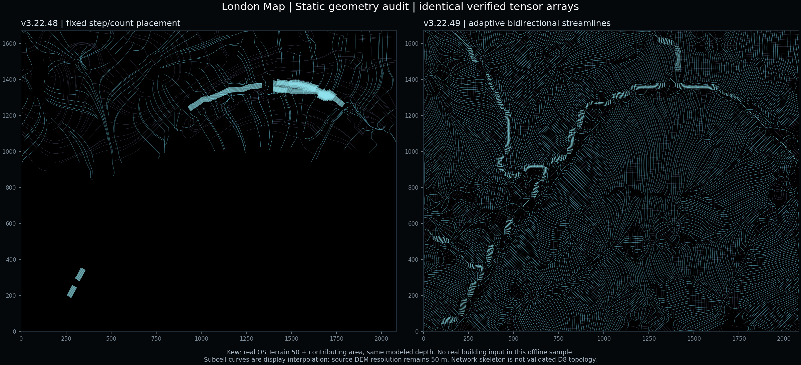

# London Map 第三阶段：静态流线几何重构

版本：`3.22.49-tensor-streamlines`。比较基线：`c7b118e` / v3.22.48。

本次重构种子分布、积分、骨架和线束几何。第二阶段的 `hydro_tensor_worker.js`、洪水计算 `local_flood_worker.js` 和共同网格工具逐字节不变。参考图仅用于疏密、长曲线和主次层次的组织；没有提取、描摹或复制参考图的河流。



## 找到的问题

1. **固定数量与固定积分步数造成面积覆盖不足。** 旧 `buildLines()` 使用全场最多 460 条、默认约 276 条的总预算；步长和预算按格子数计算，没有按屏幕尺度及场地真实尺寸调整。加大场地后，物理覆盖和长度都没有相应增长。
2. **占格去重无法控制真实线间距。** 旧算法仅记录路径经过的部分格子，没有检查实际线段距离，容易同时出现局部聚团与大片空白。按候选序列达到上限就停止，后面的空间缺口没有修复机会。
3. **汇水掩膜有数据，不代表旧线束积分有方向。** 旧 `buildRibbons()` 仅从 `trunkMask` 选择种子，且要求正的 `corridorRank`。`hydroTrace()` 又依赖 `corridorAxisX/Y`。有掩膜、但局部 PCA 方向缺失或插值抵消时，可能没有种子或积分立即终止；固定的 14 点门槛进一步淘汰结果。最终计数 0 不能一概解释为没有汇水。
4. **旧线束偏移没有逐线段检查。** 只检查偏移点，可能让连接两点的线段越过掩膜缺口。新逻辑逐段复核。
5. **重构中额外检查了骨架完整性。** 不能因为一条骨架链有一条非法边就丢弃整条链。现在保留合法子链；只有源掩膜本来存在合法正交绕行格时才绕行，其余断开。本样本 21 条非法连接被断开，520 个骨架格全部在保留子链中得到表示。

Kew 对照样本的旧版线束是 210 条，并非 0 条。用户之前出现 0 条的具体场地未提供坐标，本报告不声称复现了该场地。已通过独立用例验证：**真实汇水掩膜存在、PCA 轴全部缺失时，新算法仍能从掩膜提取骨架并生成合法线束**；没有达到阈值的源通道时，仍然返回 0，并明确说明原因。

## 当前生成方法

- `hydro_tensor_field.js` 的 `buildLines()`、`buildRibbons()` 负责接收几何结果及地图坐标转换。纯几何引擎位于 `hydro_tensor_geometry.js`，由独立 Worker 运行。张量计算与几何计算分开，快速更新只保留最新待处理任务，过期结果不会覆盖新场地或年份。
- **种子：** 根据屏幕米/像素、有效方向面积及角度变化进行确定性的自适应分块；先处理具有较长积分潜力的种子，再沿已接受曲线的法向扩展邻近种子，最后扫描有方向支持但尚未覆盖的区域。没有随机补线。
- **积分：** 双向 RK4，物理米制步长，整步与两个半步误差检查，高曲率时减小步长。双角度轴插值处理特征向量的正负等价，避免符号翻转导致断线。
- **间距和长度：** 同方向族按实际线段距离控制间隔；主、次方向族允许相交，形成交织。长度目标随视域尺寸调整；最短保留长度以物理米计。安全预算按有效面积与间隔估算顶点数，不设固定的流线条数目标。本样本两个方向族都未触及预算。
- **平滑：** 小幅受约束的曲率平滑，每次移动后检查方向吻合、掩膜及连接段。边界、障碍或低置信区域不能被平滑跨越。
- **排水线束：** 从原有 `drainageMask ∩ validMask` 细化得到中轴图，保留合法连通链，沿骨架弧长追踪中心线；侧线仅在源通道有足够真实宽度时生成，按物理间距展开，不把多条线挤进一个窄格。按观测汇水面积排序区分较强主干和较弱支流；不是声称恢复了真实上下游级序。
- **静态分析：** 默认分析模式、黑底、二维、完整显示已生成几何；默认发光与速度均为 0。没有按年份裁短线或按年份增加线条来替代方向变化。原有第二阶段张量随真实情景数据重算。

## 同数据复算结果

区域：Kew，`[-0.31, 51.475, -0.28, 51.49]`。原始 DEM 和汇水栅格文件 SHA 已核验；采用现有洪水审计生成的同一水深帧。网格 223 × 179，39,917 个有效格；方向支持格 39,471。网格地面间隔约 9.34 m，**DEM 源精度仍然是 50 m**。本离线样本没有载入真实建筑。

| 指标 | v3.22.48 | v3.22.49 |
|---|---:|---:|
| 主方向覆盖率 | 23.23% | 97.83% |
| 次方向覆盖率 | 27.60% | 99.65% |
| 主次方向线总数 | 276 | 1,869（主 1,131 / 次 738） |
| 方向线长度 P90 | 331.67 m | 509.35 m |
| 方向线长度中位数 | 303.36 m | 185.11 m |
| 小于 50 m 的方向线 | 1 | 0 |
| 汇水线束数 | 210 | 160 |
| 汇水线束长度中位数 | 73.98 m | 94.09 m |
| 小于 50 m 的线束 | 27 | 0 |

覆盖率由独立线段距离程序计算：在同一批有方向支持的格心上，距离同族曲线不超过该族设计间隔的 1.5 倍，计为覆盖。主/次间隔分别为 9.27 / 12.51 m。它不是水文准确率，也不包含无方向依据区域。

中位长度没有整体增加：新版本覆盖了原先空白、受局部方向变化限制的区域，纳入了更多中等长度的合法曲线。长曲线 P90 增加且极短碎线消失，但不能表述为“每条都更长”。汇水线束数量减少也不是退步：移除了短碎片及无宽度依据的偏移线，没有为了数量填补断开的通道。

### 汇水线束漏斗

| 阶段 | 当前样本 |
|---|---:|
| 源排水掩膜格 | 2,371 |
| 有效细化骨架格 | 520 |
| 在合法子链中保留的骨架格 | 520 |
| 合法骨架子链 | 30 |
| 种子 / 积分尝试 | 198 / 198 |
| 积分成功的种子 | 154 |
| 积分产生的候选分段 | 285 |
| 长度筛选淘汰 | 133（含 8 条在播种前淘汰的短骨架链） |
| 最终线束 | 160（主干 52 / 支流 108） |

“成功种子数”与“候选分段数”不同：一条侧向种子路径可能因通道宽度或间距约束分裂成多个候选段。因此长度淘汰数不能直接从种子数相减；本例 `285 − (133 − 8) = 160`。

网页现有状态文字显示骨架格、种子、积分成功、候选段、长度淘汰和最终线束。控制台可运行：

```js
const geometry = window.getLondonHydroTensorGeometryData();
console.table(geometry?.diagnostics.ribbons);
// geometry.field / geometry.ribbons / geometry.skeleton 为 GeoJSON。
// geometry.pending 表示新结果仍在计算；scenario 是当前导出几何所属年份。
```

0 条的具体原因通过 `ribbons.reason` 区分：没有达到阈值的源格、阈值掩膜几乎覆盖全场无法定位通道、没有骨架、没有种子、积分受阻、长度或间距全部淘汰。不会通过虚构通道把这些状态伪装为非零。

## 验证与边界

- `node scripts/test_hydro_tensor.mjs`：18 组通过，包括第二阶段方向/权重、共同网格、年份水深快照，以及几何 Worker 更新合并与过期结果淘汰。
- `node scripts/test_hydro_tensor_geometry.mjs`：12 组通过，包括面积和缩放自适应、长双方向曲线、符号翻转、建筑与场地洞、低置信缺口、缺失 PCA 轴、排水缺口、非法骨架边保留合法长链、确定性及源数组不变。
- `python scripts/build_tensor_geometry_audit.py`：从仓库真实栅格重建比较图及 JSON；独立计算前后覆盖率。比较脚本需要保留基线 commit `c7b118e` 的 git 历史。
- 第二阶段张量数组前后 SHA-256 相同：`3e60c5ca5df3e4442a4b068221019ecdc9275607ad30480fec202e3c22a3d48c`。未写入 DEM、累积面积、水深或洪水状态。
- 该样本纯几何计算约 7 秒，已放到独立 Worker；这不是浏览器端性能基准。当前环境未完成真实地图浏览器交互验收。

现有资产只有标量汇水面积及 DEM，没有原始 D8 下游链接或实测水系拓扑。因此骨架是**实际阈值掩膜的几何中轴**，不能冒充经验证的真实河流主支拓扑。图中断开或较窄的线束保留源数据限制。更密的亚格网曲线只是显示插值，不是新增地形测量。

建筑与边界以现有计算网格的有效/障碍掩膜约束，已通过合成建筑和场地孔洞的独立线段相交检查。离线 Kew 图没有真实建筑输入，不能据此宣称完成真实建筑逐栋验收；显示建筑的开关不改变障碍掩膜。

完整数值：[tensor-streamlines-audit.json](tensor-streamlines-audit.json)。静态大图：[tensor-streamlines-static.webp](tensor-streamlines-static.webp)。
